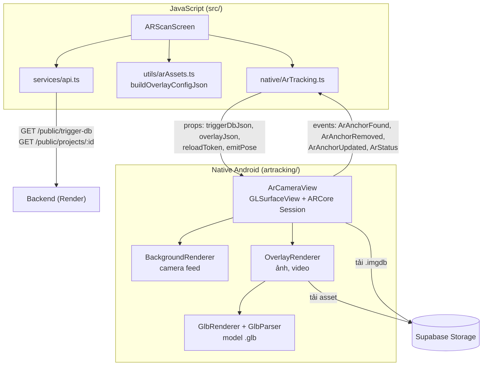

# App-Architecture

React Native 0.86 (New Architecture + Hermes bật trong `android/gradle.properties`), **chỉ Android**. Không dùng thư viện AR bên thứ ba: phần AR là native module tự viết trên ARCore SDK 1.49 + OpenGL ES 2 (đã gỡ `react-viro`). Thư mục `ios/` chỉ là template mặc định, chưa có AR ([[Mobile-Roadmap]]).

App **không có màn nhập Project ID**: tải một database nhận diện chứa trigger image của mọi project đã publish, ARCore nhận ra ảnh nào thì hiện nội dung của project đó.

## Luồng chính
1. `ARScanScreen` xin quyền camera, gọi `GET /public/trigger-db` ([[API-Client]], [[Scan-Flow]]).
2. Truyền `{version, url, sha256}` xuống native qua prop `triggerDbJson`. Native tải file `.imgdb`, kiểm tra sha256, cache lại ([[Trigger-DB-Cache]]) rồi tạo ARCore Session ([[Native-ArCameraView]]).
3. ARCore nhận ra ảnh → event `ArAnchorFound` với `name` = project id.
4. JS gọi `GET /public/projects/:id`, đổi toạ độ asset sang mét ([[Coordinate-Conversion]]) và truyền qua prop `overlayJson`.
5. Native vẽ asset lên marker mỗi frame ([[Overlay-Rendering]], [[GLB-Support]]).

## Quyết định thiết kế đáng nhớ
- **Database nhận diện dựng trên server** (`arcoreimg`), không dựng trên máy: app chỉ tải một file, không bao giờ có database thiếu ảnh nằm lại trong cache.
- **Vẽ chung GL context với camera**: model và camera cùng frame nên không trễ hình (khác cách overlay Filament ở view riêng).
- **Target và asset đi chung một prop** (`overlayJson`): native không bao giờ vẽ asset của project này lên pose của project khác.
- Hằng số `NOMINAL_MARKER_WIDTH = 0.15` m phải khớp backend ([[Coordinate-Conversion]]).
- App là repo riêng, không nằm trong pnpm workspace của repo chính vì xung đột version `react` ([[Mobile-Setup]]).

Cấu trúc file: xem bảng trong `README.md`.
