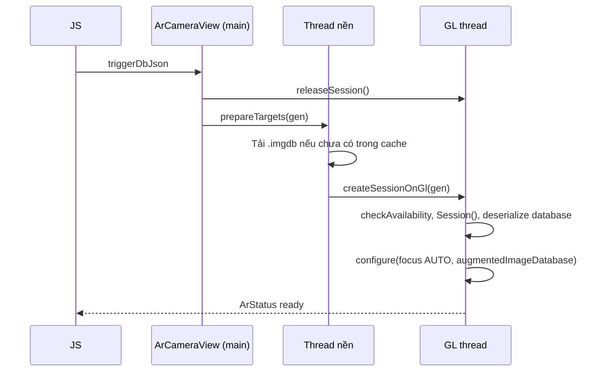

# Native-ArCameraView

`android/app/src/main/java/com/armobile/artracking/`. Một view native duy nhất, đăng ký **thủ công** (không autolink): `ArTrackingPackage` được thêm vào `packageList` trong `MainApplication.kt`.

| File | Việc |
|---|---|
| `ArTrackingPackage.kt` | Đăng ký `ArCameraViewManager`, không có native module |
| `ArCameraViewManager.kt` | `SimpleViewManager` tên `ArCameraView`: map props, phát event qua `RCTDeviceEventEmitter`, gắn lifecycle |
| `ArCameraView.kt` | `GLSurfaceView` (GLES2) giữ ARCore `Session`, nhận diện ảnh, gọi renderer mỗi frame |
| `BackgroundRenderer.kt` | Vẽ camera feed (external OES texture), cập nhật texcoord theo hướng xoay màn hình mỗi frame |
| `OverlayRenderer.kt`, `GlbRenderer.kt`, `GlbModel.kt` | [[Overlay-Rendering]], [[GLB-Support]] |

Binding JS: `src/native/ArTracking.ts` (`requireNativeComponent` + helper `add…Listener`).

## Props (JS → native)
| Prop | Kiểu | Ý nghĩa |
|---|---|---|
| `triggerDbJson` | JSON `{version, url, sha256}` | Database nhận diện; đổi giá trị → đóng session cũ, dựng lại ([[Trigger-DB-Cache]]) |
| `overlayJson` | JSON `{target, assets}` | Asset của project đang active ([[Coordinate-Conversion]]) |
| `reloadToken` | số | Đổi số → dựng lại database + session mà không gỡ view (nút "Thử lại") |
| `emitPose` | bool | Debug: bắn `ArAnchorUpdated` mỗi frame. Mặc định tắt vì nặng bridge (~60 event/giây/marker) |

## Events (native → JS)
Phát toàn cục qua `DeviceEventEmitter`, không gắn với instance view:

| Event | Payload | Khi nào |
|---|---|---|
| `ArAnchorFound` | `{name}` | Ảnh bắt đầu được track **FULL_TRACKING** |
| `ArAnchorRemoved` | `{name}` | Ảnh mất track, hoặc chỉ còn `LAST_KNOWN_POSE` (extended tracking) |
| `ArAnchorUpdated` | `{name, tx..tz, qx..qw}` | Mỗi frame, chỉ khi `emitPose` |
| `ArStatus` | `{state, message?}` | `loading` / `ready` / `error` kèm thông báo tiếng Việt |

`name` là tên ảnh trong database = project id.

## Dựng session

- **Session tạo trên GL thread**, không trên thread nền thuần: tạo ở thread nền làm ARCore ném `FatalException`. Thread nền chỉ tải file.
- `SESSION_LOCK` đảm bảo toàn process chỉ tạo 1 Session tại một thời điểm.
- `loadGeneration` tăng mỗi lần dựng lại hoặc destroy; việc nền thấy lệch số thì bỏ, tránh session cũ đè session mới.
- Session có thể xong **sau** `onSurfaceChanged`, nên `finishSetup` set lại display geometry.
- Lỗi khả dụng ARCore (máy không hỗ trợ, chưa cài/cũ "Google Play Services for AR", người dùng từ chối cài) đều đổi thành `ArStatus error` với thông báo riêng ([[Mobile-Troubleshooting]]).

## Mỗi frame (`drawFrame`)
1. `session.update()`, vẽ nền camera.
2. Ảnh mới thấy lần đầu nằm trong `getUpdatedTrackables`; giữ tham chiếu trong `knownImages` rồi hỏi trạng thái mỗi frame. Không quét `getAllTrackables` vì database có thể tới 1000 ảnh.
3. Chỉ `TRACKING` + `FULL_TRACKING` mới tính là "đang thấy" — phát Found/Removed khi trạng thái đổi, bật/tắt overlay nếu đó là target active.
4. Có pose của target active và có asset → `overlay.draw(view, proj, pose)` (near 0.05, far 100).

## Lifecycle
`ArCameraViewManager` gắn `LifecycleEventListener`: pause/resume session và video theo Activity; `onHostDestroy` hủy mọi việc nền và đóng session. Khi React gỡ view, `onDropViewInstance` → `dispose()` gỡ listener (trước đây listener rò rỉ và session không bao giờ đóng).

Manifest yêu cầu quyền `CAMERA`, `INTERNET`, `VIBRATE`, `uses-feature android.hardware.camera.ar` (lọc trên Play Store) và meta-data `com.google.ar.core = required`.
