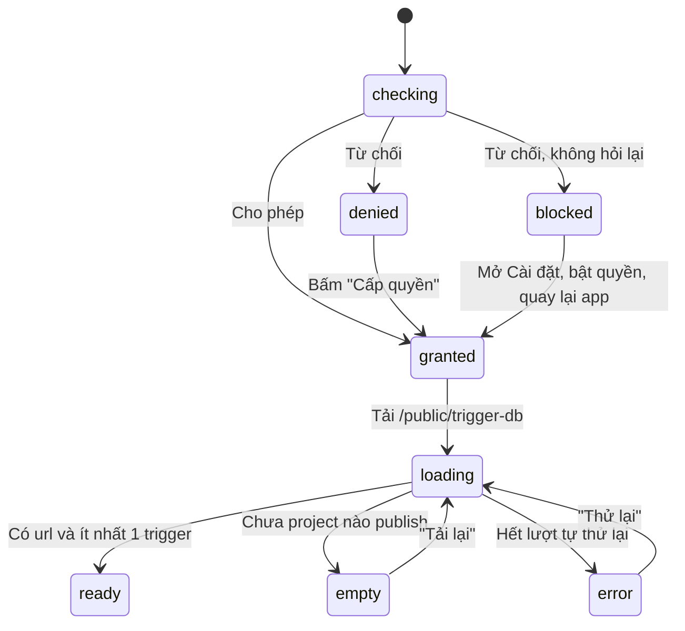

# Scan-Flow

`src/screens/ARScanScreen.tsx` — màn hình duy nhất của app (`App.tsx` chỉ bọc `SafeAreaProvider`).

## Các lớp trạng thái
Màn hình đi qua 3 cổng, cổng sau chỉ xét khi cổng trước đã qua:

1. **Quyền camera** (`CameraPermission`): `checking | granted | denied | blocked`. Khi `denied`/`blocked`, app nghe `AppState`: người dùng bật quyền trong Cài đặt rồi quay lại thì vào màn quét luôn.
2. **Danh sách trigger** (`ListPhase`): `loading | error | empty | ready`.
3. **Trạng thái AR native** (`ArStatusEvent` từ event `ArStatus`): `loading | ready | error`. Hiện lớp phủ đen kèm thông báo khi chưa `ready` ([[Native-ArCameraView]]).

## Tải database có tự thử lại
`loadList` gọi `fetchTriggerDb` ([[API-Client]]):
- Lỗi `retryable` (timeout, rớt mạng, 5xx, 503 "đang dựng database") → tự thử lại tối đa `MAX_AUTO_RETRY = 4` lần, cách nhau `AUTO_RETRY_DELAY_MS = 4000` ms, hiện message của lỗi trong lúc chờ.
- Sau `SLOW_HINT_DELAY_MS = 6000` ms vẫn đang tải → hiện gợi ý "máy chủ có thể cần tới 1 phút để khởi động" (Render free ngủ).
- `loadSeq` là số thứ tự lượt tải: bấm "Thử lại" giữa chừng hoặc unmount thì vòng cũ thấy lệch số và dừng.
- Nút "Thử lại" (`retryAll`) vừa tăng `reloadToken` (native dựng lại session) vừa gọi lại `loadList`.

## Chọn project đang active
Native báo theo tên ảnh (= project id). JS giữ `trackedRef` (tập ảnh đang được track thật) và `activeIdRef` (project đang hiện nội dung):

- `ArAnchorFound(name)`: thêm vào tập. Nếu project active hiện tại **vẫn đang được nhìn thấy** thì giữ nguyên (tránh nhấp nháy khi 2 ảnh cùng trong khung); ngược lại `activate(name)`.
- `ArAnchorRemoved(name)`: bỏ khỏi tập. Nếu đó là project active và còn ảnh khác đang track → chuyển sang ảnh đó. Không còn ảnh nào → **giữ** project active (nội dung đã tải) để nhìn lại là hiện ngay.
- `activate(id)`: gọi `fetchPublicProject`, rung 40 ms khi thành công. Lỗi → hiện badge đỏ và thử lại **1 lần** sau 2.5 s nếu ảnh vẫn đang được nhìn thấy.

Từ project active, `overlayJson` được tính bằng `buildOverlayConfigJson(id, assets, NOMINAL_MARKER_WIDTH)` ([[Coordinate-Conversion]]).

## Giao diện trên camera
- Chưa thấy ảnh nào: khung ngắm `ScanFrame` (4 góc "thở" nhẹ, `src/components/ScanFrame.tsx`) + chữ hướng dẫn.
- Đang thấy ảnh: badge trên cùng — xanh với tên project khi nội dung đã sẵn sàng, đen kèm spinner "Đang tải nội dung..." khi chưa.
- Lỗi tải nội dung: badge đỏ bên dưới.

Toàn bộ chữ trên giao diện là tiếng Việt, viết thẳng trong component (chưa có i18n). Thông báo lỗi và cách xử lý: [[Mobile-Troubleshooting]].
