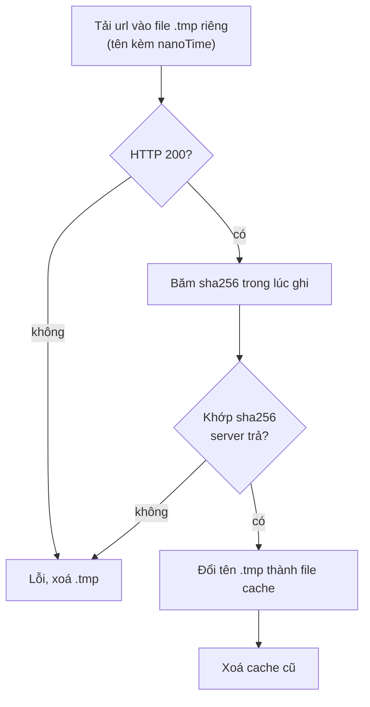

# Trigger-DB-Cache

ARCore cần một `AugmentedImageDatabase` để nhận diện ảnh. Server dựng sẵn file `.imgdb` chứa trigger image của mọi project đã publish (tên mỗi ảnh = project id, bề rộng 0.15 m) và trả về qua `GET /public/trigger-db` ([[API-Client]]). Cách server dựng: note `Trigger-Database` ở wiki repo chính.

Phần mobile nằm trong `ArCameraView.kt` (`prepareTargets`, `downloadDatabase`, `loadCachedDatabase`).

## Cache
- Tên file theo **sha256 nội dung**: `cacheDir/armobile_trigger_<32 ký tự hex đầu>.imgdb`. File khác nội dung không bao giờ trùng tên, nên không cần so `version`.
- Có file rồi thì mở app lần sau chỉ deserialize, không tải lại.
- Sau khi lưu bản mới, xoá mọi file `armobile_*.imgdb` khác (kể cả cache `armobile_aug_*` của bản app cũ dựng database trên máy).

## Tải an toàn

- File trong cache **luôn là bản đầy đủ** đúng như server dựng: tải lỗi, cụt hay hỏng đều ném lỗi và không để lại gì.
- Mỗi lần tải dùng tên tạm riêng nên 2 view cùng tải không ghi đè nhau.
- Timeout: kết nối 15 s, đọc 30 s.

## Khi cache hỏng
Nếu deserialize thất bại: xoá file cache và **tải lại đúng 1 lần** (`retried`). Lần 2 vẫn lỗi thì báo `ArStatus error` "Database nhận diện không đọc được" — không lặp vô hạn khi file trên server hỏng. Database đọc được nhưng 0 ảnh → báo lỗi luôn.

Server xoá file `.imgdb` cũ ngay sau khi trỏ sang bản mới; máy đang tải dở bản cũ chỉ cần bấm "Thử lại" ([[Scan-Flow]]).

Liên quan: [[Native-ArCameraView]], [[Mobile-Troubleshooting]].
